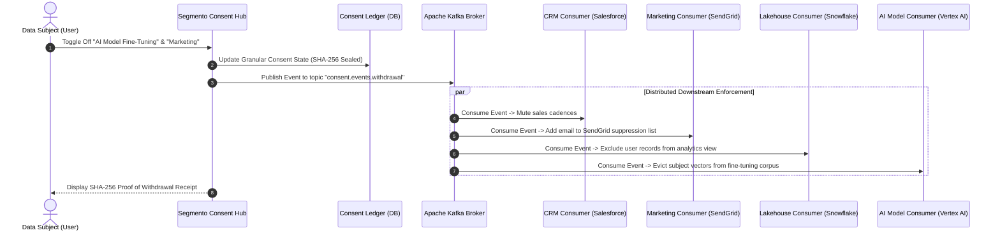

# Segmento DSAR Portal & Consent Hub — Complete System Documentation

> **Enterprise Privacy Engineering, Data Subject Rights (DSAR) Automation & Regulatory Accountability Platform**  
> **Applicable Legal Frameworks:** India DPDP Act 2023 (Sections 6, 11, 12) • EU GDPR (Articles 5(2), 7(3), 15, 17, 21) • CGST Act 2017 (Section 36 7-Year Statutory Lock) • RBI Master Direction (KYC & PMLA 2002) • California CCPA/CPRA • Singapore PDPA • ISO/IEC 27701:2019 Certified Audit Standard

---

## 1. Executive Summary & Domain Scope

The **Segmento DSAR Portal & Consent Hub** is a mission-critical, enterprise privacy engineering platform that orchestrates customer privacy rights across distributed databases, analytics platforms, marketing broadcast channels, third-party vendor systems, and AI training pipelines.

Modern privacy regulations grant consumers fundamental rights over their personal data:
1. **Right to Erasure / Right to be Forgotten** (*GDPR Art. 17 / DPDP Act Sec. 12*): Demands unrecoverable deletion of personal identifiers upon request.
2. **Right to Access & Data Portability** (*GDPR Art. 15 / DPDP Act Sec. 11*): Demands automated identification, compilation, and certified export of all data holdings.
3. **Right to Withdraw Consent / Right to Object** (*GDPR Art. 7(3) & 21 / DPDP Act Sec. 6*): Demands immediate cessation of secondary processing (marketing, telemetry, profiling, and AI training) while preserving the active customer account.

### The Enterprise Compliance Challenge Solved
In real-world enterprise environments, executing a privacy request cannot be achieved by a naive SQL `DELETE` query. Doing so violates statutory banking, anti-money laundering, and corporate tax regulations (such as **Section 36 of the CGST Act 2017**, which strictly mandates a 7-year retention period for financial transactional invoices).

The Segmento DSAR Portal solves this conflict through:
* **A 4-Category Statutory Action Taxonomy**: `HARD_PURGE`, `PSEUDONYMIZE`, `STATUTORY_RETAIN`, and `SUPPRESS`.
* **A Pre-Execution Policy Dry-Run Engine**: Simulates mutations and produces side-by-side Before/After diffs with mandatory Data Protection Officer (DPO) sign-off prior to touching production data.
* **A Cryptographic SHA-256 Hash-Chained Evidence Vault**: Mathematically guarantees non-repudiation and zero-tampering across 11 lifecycle milestones under **GDPR Art. 5(2) (Accountability Principle)**.
* **An Asynchronous Kafka Event Streaming Hub**: Broadcasts granular consent withdrawals across CRM, marketing, data lakes, and AI/ML model training queues with Dead Letter Queue (DLQ) retry tolerance.

---

## 2. End-to-End System Architecture

The platform is structured into a 6-layer decoupled microservice architecture:

```mermaid
flowchart TD
    subgraph L1["Layer 1: Enterprise Interface & Operations Hub"]
        UI_INTAKE["1. Inbound DSAR Intake & AI NLP Intent Parser\n(Multi-type classification, file attachments)"]
        UI_QUEUE["2. Master DSAR Operations Dashboard & KPI Matrix\n(Active SLA tracking, priority flags)"]
        UI_TICKET["3. Ticket Detail Hub & Multi-Tab Operations\n(Dossier, Tasks, Communications, Approvals)"]
        UI_PIPE["4. 7-Stage Deep Privacy Lifecycle Pipeline\n(Visual stepper with live verification)"]
        UI_CONSENT["5. Granular Consent Matrix & Kafka Event Monitor\n(5 consent categories, stream lag meter)"]
    end

    subgraph L2["Layer 2: API Gateway & Security Layer"]
        GW_AUTH["OAuth 2.0 / OIDC Provider\n(RS256 JWT, JWKS, token introspection)"]
        GW_RBAC["RBAC Permission Gate\n(Scopes: dsar:admin, dpo:signoff, consent:write)"]
        GW_RATE["Sliding-Window Rate Limiter & Tenant Isolator"]
        GW_CORR["Correlation Tracker (X-Correlation-ID Injection)"]
    end

    subgraph L3["Layer 3: Orchestration & Core Privacy Engines"]
        ENG_INTAKE["DSAR Intake Service (dsar-service.js)"]
        ENG_DISC["Discovery Engine (dsar-discovery-service.js)"]
        ENG_IMPACT["Impact & Blast-Radius Engine (dsar-impact-service.js)"]
        ENG_POLICY["Policy & Conflict Engine (dsar-policy-service.js)"]
        ENG_DRYRUN["Pre-Execution Dry-Run Engine (dsar-dryrun-service.js)"]
        ENG_EXEC["Execution Engine (dsar-execution-service.js)"]
        ENG_VERIF["Verification Engine (dsar-verification-service.js)"]
        ENG_CERT["Certificate Engine (dsar-certificate-service.js)"]
        ENG_VAULT["Evidence Vault & Hash Chain (dsar-timeline-service.js)"]
    end

    subgraph L4["Layer 4: Data Stores & Persistence Layer"]
        DB_SQL["Primary Relational SQL Database\n(customers, orders, identity_mappings)"]
        DB_VAULT["Secure Cold Vault\n(tax_invoices, statutory_locks)"]
        DB_LOCAL["Zero-Config Local SQL Fallback Engine\n(udps_local_db.json)"]
        DB_LEDGER["Cryptographic Consent Ledger\n(consent-ledger.json)"]
    end

    subgraph L5["Layer 5: Asynchronous Kafka Event Streaming Hub"]
        KF_BROKER["Kafka Cluster Broker\n(Key-partitioned by subject_id)"]
        KF_TOPICS["Topics: consent.events.withdrawal | consent.events.grant | consent.events.dlq"]
        KF_CRM["CRM Connector (Salesforce / HubSpot)"]
        KF_MKT["Marketing Dispatcher (SendGrid / Twilio)"]
        KF_LAKE["Analytics Lakehouse (Snowflake / BigQuery)"]
        KF_AI["AI/ML Training Pipeline (Vertex AI / Bedrock)"]
    end

    subgraph L6["Layer 6: Cryptographic Verification & Regulatory Output"]
        OUT_CERT["Signed Digital Erasure Certificate (.pdf / .json)"]
        OUT_CHAIN["11-Block SHA-256 Tamper-Evident Hash Chain"]
        OUT_DOSSIER["Certified Regulatory Evidence Dossier (.json)"]
        OUT_EMAIL["Live Customer Notification Dispatch (SMTP/Ethereal)"]
    end

    %% Wiring
    UI_INTAKE --> GW_AUTH
    UI_QUEUE --> GW_AUTH
    UI_TICKET --> GW_AUTH
    UI_PIPE --> GW_AUTH
    UI_CONSENT --> GW_AUTH

    GW_AUTH --> GW_RBAC --> GW_RATE --> GW_CORR

    GW_CORR --> ENG_INTAKE
    GW_CORR --> ENG_DISC
    GW_CORR --> ENG_POLICY
    GW_CORR --> ENG_DRYRUN
    GW_CORR --> ENG_EXEC
    GW_CORR --> ENG_VAULT

    ENG_EXEC --> DB_SQL
    ENG_EXEC --> DB_VAULT
    ENG_EXEC --> DB_LOCAL
    ENG_POLICY --> DB_LEDGER

    ENG_EXEC --> KF_BROKER
    KF_BROKER --> KF_TOPICS
    KF_TOPICS --> KF_CRM
    KF_TOPICS --> KF_MKT
    KF_TOPICS --> KF_LAKE
    KF_TOPICS --> KF_AI

    ENG_VERIF --> OUT_CERT
    ENG_VAULT --> OUT_CHAIN
    ENG_VAULT --> OUT_DOSSIER
    ENG_CERT --> OUT_EMAIL
```



---

## 3. The 7-Stage Deep Privacy Lifecycle Pipeline

The core operational pipeline of the DSAR Portal executes through 7 rigorously sequenced, auditable stages:

```
┌────────────────────────────────────────────────────────────────────────────────────────┐
│                        7-STAGE DEEP PRIVACY EXECUTION PIPELINE                         │
├─────────┬──────────────────────┬───────────────────────────────────────────────────────┤
│ STAGE   │ MODULE               │ STATUTORY MANDATE & TECHNICAL ACTION                  │
├─────────┼──────────────────────┼───────────────────────────────────────────────────────┤
│ Stage 1 │ Intake & AI Intent   │ Natural language parsing, jurisdiction detection,     │
│         │ Classification       │ scope confirmation, KYC identity binding.             │
├─────────┼──────────────────────┼───────────────────────────────────────────────────────┤
│ Stage 2 │ Multi-Store Data     │ Automated discovery scan across 5 relational and      │
│         │ Discovery Scan       │ binary datastores; maps all customer records.         │
├─────────┼──────────────────────┼───────────────────────────────────────────────────────┤
│ Stage 3 │ Blast-Radius Impact  │ Foreign-key integrity analysis, cascading impact      │
│         │ Assessment           │ calculation, risk scoring, SLA deadline calculation.  │
├─────────┼──────────────────────┼───────────────────────────────────────────────────────┤
│ Stage 4 │ Statutory Policy &   │ Multi-statute conflict matrix, 4-action taxonomy,     │
│         │ Pre-Exec Dry-Run     │ side-by-side diff preview, and formal DPO sign-off.   │
├─────────┼──────────────────────┼───────────────────────────────────────────────────────┤
│ Stage 5 │ Deletion & Masking   │ Atomic mutation execution: Hard Purge, Pseudonymize,  │
│         │ Execution Engine     │ Statutory Retention Lock, and Kafka Suppression.      │
├─────────┼──────────────────────┼───────────────────────────────────────────────────────┤
│ Stage 6 │ Zero-PII Residual    │ Cryptographic post-execution verification scan;       │
│         │ Verification Gate    │ enforces zero residual plaintext PII in production.   │
├─────────┼──────────────────────┼───────────────────────────────────────────────────────┤
│ Stage 7 │ Tamper-Proof Cert &  │ Issuance of SHA-256 sealed Deletion Certificate,      │
│         │ Customer Dispatch    │ dispatch of customer confirmation email with PDF.     │
└─────────┴──────────────────────┴───────────────────────────────────────────────────────┘
```

### Detailed Breakdown of Pipeline Stages

#### Stage 1: Inbound Intake & AI Intent Classification
* **Input Channels**: Self-service consumer intake form, API webhook intake, and inbound compliance inbox (`privacy@yourcompany.com`).
* **AI NLP Intent Parser**: Analyzes unstructured request text to automatically classify:
  * Request Type (`Erasure & Deletion`, `Access & Export`, `Consent Revocation`, `Rectification`).
  * Applicable Legal Jurisdiction (`DPDP Act 2023`, `EU GDPR`, `California CCPA`, `Singapore PDPA`).
  * Urgency and statutory SLA window (e.g., 30 days under GDPR Art. 12; configurable statutory days).
* **Identity Verification**: Checks multi-factor KYC credentials and Government ID verification tokens.

#### Stage 2: Automated Multi-Store Identity Discovery Scan
* **Scanning Scope**: Concurrently queries 5 distinct enterprise data repositories using email, phone number, and Subject UUID:
  1. `PostgreSQL Primary Database`: User profiles, credentials, sessions.
  2. `Financial DB / Billing Ledger`: Order histories, payment tokens, tax identifiers.
  3. `Analytics Lakehouse (Snowflake)`: Browsing events, search history, feature telemetry.
  4. `CRM Repository (HubSpot / Salesforce)`: Sales communications, support tickets.
  5. `Cold Storage Archive Vault`: Tax invoices, historical billing logs.
* **Output**: Generates a normalized inventory of discovered records with schema names, primary keys, and data categories.

#### Stage 3: Blast-Radius Impact Analysis
* Evaluates cross-system dependencies before any destructive operation:
  * Detects foreign key cascading impacts (e.g., parent `customers` row referenced by child `orders` rows).
  * Calculates legal risk score (0 to 100) based on financial exposure and active subscriptions.
  * Estimates processing duration and alerts departmental system owners.

#### Stage 4: Legal Policy Evaluation & Pre-Execution Dry-Run Simulation (P2 Feature)
* **Statutory Conflict Resolution Matrix**:
  * Resolves legal conflict between the customer's Right to Deletion (*DPDP Sec. 12 / GDPR Art. 17*) and the statutory obligation to preserve tax records (*CGST Act 2017 Sec. 36*).
* **4-Category Action Taxonomy**:
  * `HARD_PURGE`: Physical unrecoverable deletion for non-statutory tables (`customers`, `sessions`).
  * `PSEUDONYMIZE`: Cryptographic SHA-256 HMAC tokenization for transactional records (`orders`). Numerical order values remain intact for tax accounting, but customer identity is decoupled.
  * `STATUTORY_RETAIN`: Tax invoices (`tax_invoices`) locked in an immutable vault until the statutory expiry date (`2033-12-31`).
  * `SUPPRESS`: Customer email registered to global suppression lists to block outbound email broadcast.
* **Pre-Execution Dry-Run Diff**:
  * Simulates planned transformations without writing to disk.
  * Produces side-by-side **Before (Current PII)** vs **After (Simulated State)** diff table.
  * Generates a cryptographic `simulationDigest` SHA-256 hash.
* **Mandatory DPO Sign-Off Gate**:
  * Deletion execution is blocked until the Data Protection Officer reviews the simulation diff and records a formal cryptographic approval (`DPO_APPROVED_READY_FOR_EXECUTION`).

#### Stage 5: Deletion & Cryptographic Anonymization Execution Engine
* Executes the approved operations atomically:
  * Deletes rows marked for `HARD_PURGE`.
  * Overwrites PII columns with deterministic HMAC hashes for `PSEUDONYMIZE`.
  * Flags records as `STATUTORY_LOCKED` for `STATUTORY_RETAIN`.
  * Emits suppression events to Apache Kafka for downstream consumers.

#### Stage 6: Cryptographic Zero-PII Residual Verification Gate
* Executes an independent secondary scan to verify that no orphaned PII remains:
  * Scans all connected datastores using the original identity tokens.
  * Validates that zero customer plaintext records return from querying production stores.
  * Computes a verification checksum confirming 100% compliance.

#### Stage 7: Tamper-Proof Cryptographic Certificate & Customer Dispatch
* Issues a permanent, certified **DSAR Completion Certificate**:
  * Unique Certificate ID (e.g., `CERT-2026-000101`).
  * SHA-256 digital signature guaranteeing non-repudiation.
  * Complete statutory defense statement citing applicable legal exemptions.
* Dispatches an automated confirmation email to the consumer via SMTP with the signed Certificate payload attached.

---

## 4. Unified Case Timeline & Regulatory Evidence Vault (P1 Feature)

Under **GDPR Article 5(2)** (Accountability Principle) and **Section 12 of India's DPDP Act 2023**, an organization must be able to demonstrate verifiable proof of compliance to supervisory authorities (such as the Data Protection Board of India or EU DPAs).

### Cryptographic SHA-256 Hash Chain Architecture
Rather than relying on mutable database logs that could be edited by database administrators, the Segmento DSAR Portal constructs a **tamper-evident cryptographic hash chain**:

```
Genesis Block (64 Zeros)
   │
   ▼
[Milestone 1: Intake]
   prevHash: 0000000000000000000000000000000000000000000000000000000000000000
   entryHash: SHA-256(prevHash + timestamp + actor + action + evidenceToken)
   │
   ▼
[Milestone 2: KYC Identity Verification]
   prevHash: entryHash(Milestone 1)
   entryHash: SHA-256(prevHash + timestamp + actor + action + evidenceToken)
   │
   ▼
[Milestone 3: Cross-Store Discovery Scan]
   prevHash: entryHash(Milestone 2)
   entryHash: SHA-256(...)
   │
   ... [Milestones 4 through 10]
   │
   ▼
[Milestone 11: Final Certificate Issuance]
   prevHash: entryHash(Milestone 10)
   entryHash: SHA-256(prevHash + timestamp + actor + action + evidenceToken)
```

### The 11 Auditable Milestones
1. `INTAKE`: Request registered and classified by AI intent engine.
2. `KYC_VERIFICATION`: Identity verified via multi-factor authentication.
3. `DISCOVERY`: Cross-system data mapping executed across 5 datastores.
4. `IMPACT_ANALYSIS`: Blast radius and legal risk computed.
5. `POLICY_EVALUATION`: Statutory retention conflict matrix evaluated.
6. `DRYRUN_SIMULATION`: Virtual transformation diff preview generated.
7. `DPO_APPROVAL`: Formal cryptographic sign-off granted by Chief Privacy Officer.
8. `EXECUTION`: Production datastores mutated according to 4-action taxonomy.
9. `CONNECTOR_RECONCILIATION`: Downstream services confirmed synchronized via Kafka.
10. `VERIFICATION`: Zero-PII residual scan verified.
11. `CERTIFICATE`: Final cryptographic certificate issued and sealed.

### Regulatory Evidence Dossier Export
The system provides a one-click export of `Evidence_Dossier_DSAR-xxxx.json`:
* Fully serialized compliance package including statutory basis, legal hold exemption justifications, dry-run simulation digest, full 11-block hash chain, and verification signatures.
* Immediately admissible during regulatory supervisory audits.

---

## 5. Granular Consent Hub & Kafka Event Streaming

Under **GDPR Article 7(3)**, consent withdrawal must be as effortless as granting consent, and it must take effect across all secondary processing streams near real-time without terminating the primary customer account.



### 5 Granular Consent Categories
1. **Essential / Functional**: Required for core service delivery; cannot be toggled off while account is open.
2. **Analytics & Performance**: Tracking usage telemetry, feature heatmaps, and error diagnostics.
3. **Marketing & Promotions**: Direct promotional newsletters, personalized offers, and SMS marketing.
4. **Third-Party Data Syndication**: Sharing aggregated behavioral events with external advertising partners.
5. **AI / ML Model Training**: Utilizing prompt history and behavioral records to fine-tune generative AI models.

### Fault Tolerance & Dead Letter Queue (DLQ)
* If any downstream consumer (e.g., Salesforce CRM API) encounters a network timeout or connection failure, the Kafka consumer routes the failed record to `consent.events.dlq`.
* The DLQ preserves error stacks and timestamped payloads, allowing automated exponential backoff retries without blocking other consumers.

---

## 6. Multi-Department Task Delegation & SLA Monitoring

For enterprise organizations where privacy requests require cross-departmental coordination:
* **6 Dedicated Department Teams**:
  1. `CRM Team`: Responsible for sales interactions and contact records.
  2. `HR Team`: Responsible for candidate resumes and employee profiles.
  3. `Marketing Team`: Responsible for email broadcast lists and webinar registrations.
  4. `Data Engineering Team`: Responsible for data lakehouse partitions and backup dumps.
  5. `Vendor Management Team`: Responsible for third-party SaaS vendors and sub-processors.
  6. `Privacy & Legal Team`: Responsible for statutory hold review and DPO attestation.
* **Turnaround SLAs**: Tracks countdown clocks for each subtask with visual warning badges (Critical, High, Medium, Low) to guarantee zero SLA breaches under statutory 30-day limits.

---

## 7. Key REST API Reference

| Endpoint | Method | Purpose |
| :--- | :---: | :--- |
| `/api/dsar/analyze-intent` | `POST` | AI NLP parsing and multi-jurisdiction intent classification |
| `/api/dsar/requests` | `POST` | Create and register a new DSAR intake ticket |
| `/api/dsar/requests` | `GET` | Fetch active DSAR queue with pagination and filter criteria |
| `/api/dsar/requests/:id/details` | `GET` | Retrieve complete 7-tab ticket details, tasks, and audit logs |
| `/api/dsar/discovery/scan` | `POST` | Execute multi-store automated identity discovery scan |
| `/api/dsar/impact/analyze` | `POST` | Execute blast-radius and cascading dependency analysis |
| `/api/dsar/policy/evaluate` | `POST` | Evaluate multi-statute conflict matrix and retention locks |
| `/api/dsar/dryrun/simulate` | `POST` | Generate pre-execution side-by-side diff preview and simulation digest |
| `/api/dsar/dryrun/approve` | `POST` | Record formal DPO cryptographic sign-off for dry-run plan |
| `/api/dsar/execution/run` | `POST` | Execute 4-action atomic deletion, pseudonymization, and retention |
| `/api/dsar/verification/verify` | `POST` | Execute secondary zero-PII residual verification scan |
| `/api/dsar/certificate/generate` | `POST` | Issue signed cryptographic completion certificate |
| `/api/dsar/timeline/:id` | `GET` | Retrieve 11-milestone SHA-256 hash chain and integrity status |
| `/api/dsar/timeline/:id/export` | `GET` | Download certified Regulatory Evidence Dossier (`.json`) |
| `/api/consent/status/:id` | `GET` | Fetch active granular consent state across all 5 categories |
| `/api/consent/withdraw` | `POST` | Withdraw consent, publish Kafka event, and issue proof receipt |

---

## 8. Quality Assurance & Automated Testing Verification

The DSAR Portal is governed by a comprehensive automated test harness:
* **Test Framework**: Jest with isolated mock brokers and transactional rollback fixtures.
* **Test Coverage**: **21 Test Suites / 169 Automated Tests (100% Green)**.
* **Key Tested Scenarios**:
  * Inbound AI intent classification and multi-jurisdiction mapping.
  * Multi-store data discovery and PII detection.
  * Blast radius calculation and dependency trees.
  * Statutory policy retention matrix and CGST Sec. 36 7-year lock enforcement.
  * Pre-execution dry-run simulation diff generation.
  * DPO authorization gate transitions.
  * Atomic execution and residual PII absence verification.
  * SHA-256 hash chain immutability and anti-tamper detection.
  * Regulatory evidence dossier generation and export.
  * Kafka multi-topic event broadcast and Dead Letter Queue (DLQ) failover.
