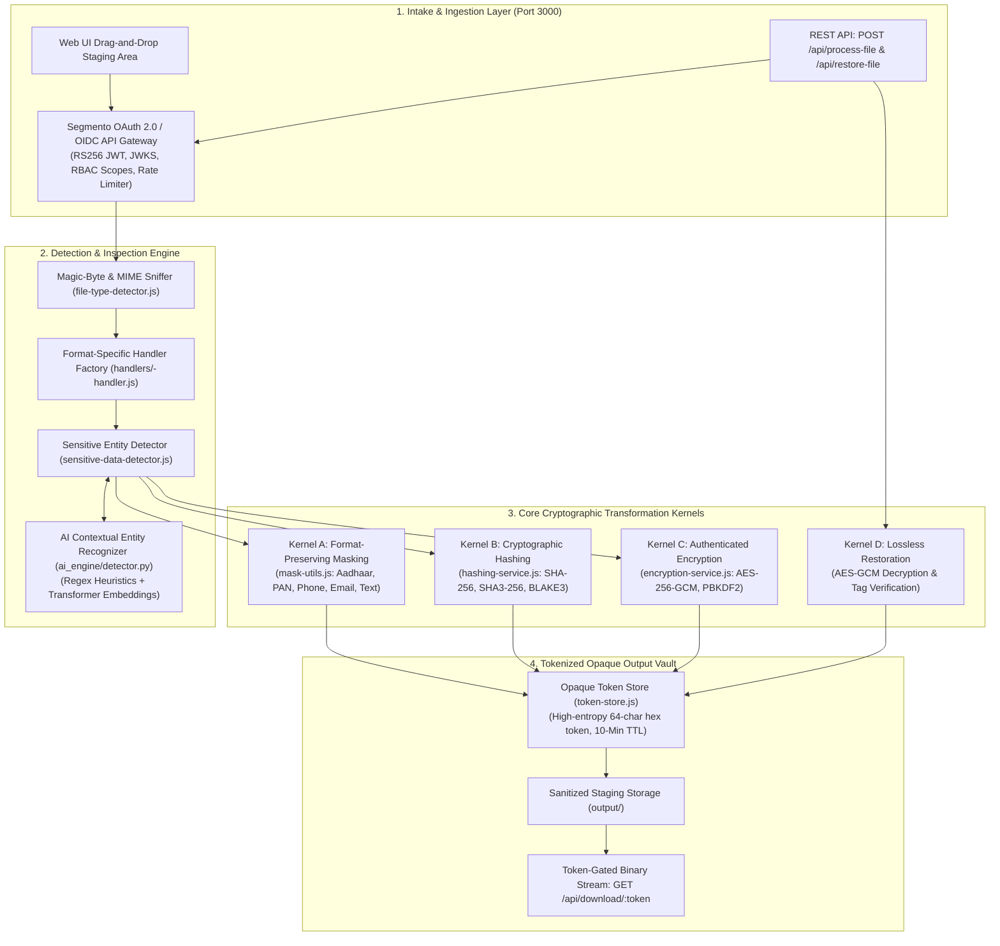
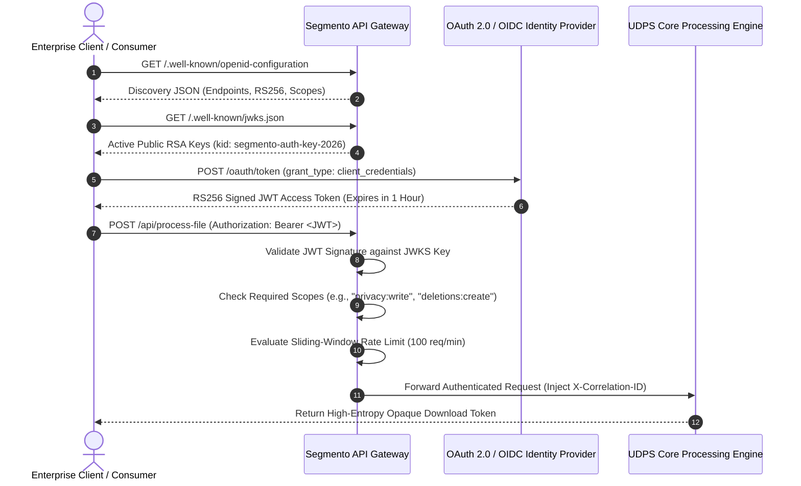

# Universal Data Protection System (UDPS) — Complete System Documentation

> **Segmento Protection Engine: Enterprise Multi-Format Privacy Transformation & Cryptographic Vault Platform**  
> **Applicable Compliance Standards:** ISO/IEC 27001 • ISO/IEC 27701 • India DPDP Act 2023 • EU GDPR (Art. 32 Security of Processing) • NIST SP 800-38D (AES-GCM) • NIST SP 800-132 (PBKDF2 Key Derivation)

---

## 1. Executive Summary & Core Engineering Mission

The **Universal Data Protection System (UDPS)**, also known as the **Segmento Protection Engine**, is an enterprise-grade, high-throughput privacy engineering and cryptographic transformation platform.

In modern enterprise architectures, sensitive personally identifiable information (PII), confidential financial records, and proprietary operational logs are scattered across dozens of heterogeneous formats: tabular databases, hierarchical semi-structured documents, columnar analytical lakehouse files, binary reports, and scanned document images.

UDPS provides a unified, format-aware transformation and encryption engine capable of processing **13+ structured, semi-structured, columnar, and binary file formats** while preserving schema definitions, structural syntax, and data types.

### Primary Transformation Pillars
1. **Format-Preserving Data Masking**: Replaces sensitive tokens (Aadhaar IDs, PAN cards, phone numbers, email addresses, names) with syntactically realistic redacted masks, enabling secure development, testing, and third-party analytics without exposing cleartext PII.
2. **Cryptographic One-Way Hashing**: Performs deterministic or keyed one-way transformations using NIST-standard **SHA-256**, Keccak **SHA3-256**, and ultra-high-throughput **BLAKE3**, enabling cryptographic identity linkage without storing raw PII.
3. **Military-Grade Authenticated Encryption (AES-256-GCM)**: Performs whole-file authenticated encryption using **PBKDF2** key derivation with 310,000 iterations, unique 256-bit salts, 96-bit initialization vectors, and 128-bit authentication tags, with full lossless decryption/restore capabilities.
4. **Tokenized Opaque Download Vault**: Eliminates internal filesystem path leakage by gating all transformed asset downloads behind high-entropy, single-use, 10-minute time-to-live (TTL) security tokens.

---

## 2. System Architecture & Component Interaction

The UDPS architecture is organized into a modular pipeline where files are inspected by magic bytes, routed through dedicated format factories, transformed by cryptographic kernels, and staged in a secure token-gated vault:



---

## 3. Supported File Formats Matrix (13+ Formats)

UDPS implements specialized streaming and DOM/schema-preserving parsers for each format:

| Format | Extensions | Masking | Hashing | Encryption | Parsing / Serialization Strategy |
| :--- | :--- | :---: | :---: | :---: | :--- |
| **CSV** | `.csv` | ✅ | ✅ | ✅ | Streamed comma-separated parser with header auto-detection |
| **TSV** | `.tsv` | ✅ | ✅ | ✅ | Tab-separated value parser with zero memory overhead |
| **JSON** | `.json` | ✅ | ✅ | ✅ | Recursive object traversal; object keys & types preserved |
| **JSONL / NDJSON** | `.jsonl`, `.ndjson` | ✅ | ✅ | ✅ | High-throughput line-by-line independent object streams |
| **YAML** | `.yaml`, `.yml` | ✅ | ✅ | ✅ | Safe-load schema parser; indentation & nesting preserved |
| **XML** | `.xml` | ✅ | ✅ | ✅ | Hierarchy-preserving parser; tags and attributes untouched |
| **HTML** | `.html`, `.htm` | ✅ | ✅ | ✅ | Cheerio DOM engine; scripts, styles, and tags untouched |
| **PDF** | `.pdf` | ✅ | ✅ | ✅ | Coordinate-based text stream redaction & AES-GCM wrapping |
| **Parquet** | `.parquet` | ✅ | ✅ | ✅ | Parquetjs-lite columnar engine; schema & dictionary intact |
| **Avro** | `.avro` | ✅ | ✅ | ✅ | Avsc schema-compliant streaming serialization |
| **ORC** | `.orc` | ✅ | ✅ | ✅ | Native PyArrow columnar processor via Python bridge |
| **JPEG** | `.jpg`, `.jpeg` | ✅ | ✅ | ✅ | Tesseract OCR bounding-box redaction & Sharp image pipeline |
| **PNG** | `.png` | ✅ | ✅ | ✅ | Alpha-channel preservation, bounding-box blurring/redaction |

---

## 4. Deep-Dive into Cryptographic & Privacy Operations

### 1. Format-Preserving Data Masking
Data masking preserves the syntactic structure and data type of PII fields while completely obscuring the true value:

* **Email Addresses**: Preserves domain while masking mailbox username.
  * Original: `ram.sharma@example.com`
  * Masked: `r***a@example.com`
* **Indian Mobile Numbers**: Preserves country code and final 4 digits for SMS verification testing.
  * Original: `+91 9876543210`
  * Masked: `+91 ******3210`
* **Aadhaar Numbers (12-Digit UIDAI)**: Complies with UIDAI Masked Aadhaar regulations.
  * Original: `1234 5678 9012`
  * Masked: `XXXX XXXX 9012`
* **Permanent Account Number (PAN Card)**: Preserves card type and check digit while obscuring core registration number.
  * Original: `ABCDE1234F`
  * Masked: `AB*****34F`
* **Names / Text Strings**: Preserves first letter and string length indicator.
  * Original: `Johnathan Doe`
  * Masked: `J******** D**`

### 2. Cryptographic One-Way Hashing
Implemented using audited, pure-JavaScript cryptographic primitives from `@noble/hashes`:

* **SHA-256 (NIST FIPS 180-4)**: The global industry standard for deterministic tokenization and referential mapping across databases.
* **SHA3-256 (NIST FIPS 202 / Keccak)**: Cryptographic sponge-function alternative providing defense against length-extension vulnerabilities.
* **BLAKE3**: Modern tree-hashing algorithm delivering extreme parallelism and speeds up to 4x faster than SHA-256 on multi-core processors.

### 3. Military-Grade Authenticated Encryption (AES-256-GCM)
Whole-file encryption adheres to the highest zero-knowledge security specifications:

```
┌────────────────────────────────────────────────────────────────────────────────────────┐
│                          AES-256-GCM ENCRYPTED FILE SPECIFICATION                      │
├───────────────────┬───────────────────┬────────────────────────────────┬───────────────┤
│ PBKDF2 SALT       │ IV (NONCE)        │ CIPHERTEXT PAYLOAD             │ AUTH TAG      │
│ (32 Bytes / 256b) │ (12 Bytes / 96b)  │ (Variable Length AES-256-GCM)  │ (16 Bytes)    │
└───────────────────┴───────────────────┴────────────────────────────────┴───────────────┘
```

* **Key Derivation Function (KDF)**:
  * Algorithm: **PBKDF2** (*Password-Based Key Derivation Function 2*).
  * Hash Primitive: HMAC-SHA-256.
  * Iteration Count: **310,000 iterations** (exceeding OWASP 2026 guidelines to prevent GPU/ASIC brute-force attacks).
  * Salt: Cryptographically secure 256-bit random salt generated via `crypto.randomBytes(32)` uniquely per file.
* **Cipher Mode**:
  * AES in Galois/Counter Mode (**AES-256-GCM**).
  * 96-bit unique initialization vector (IV) per file.
* **Integrity & Authenticity**:
  * 128-bit Authentication Tag generated by the GCM engine.
  * Detects any unauthorized bit-flip or ciphertext corruption prior to decryption.
* **Lossless Decryption (`/api/restore-file`)**:
  * Decrypts `.enc` files back into their exact original binary representation when provided with the correct user passphrase.
  * Returns an immediate HTTP 400 error if the authentication tag fails verification.

---

## 5. Security & Access Control: Segmento OAuth 2.0 / OIDC Gateway

The UDPS platform is safeguarded by an enterprise **Segmento API Gateway**:



### Security Hardening Measures
* **Zero Filesystem Path Exposure**: Internal file paths (e.g., `/var/data/uploads/file_123.csv`) are strictly hidden from clients. Clients only receive an opaque 64-character token (`e.g., 7f8a9b2c...`).
* **Time-to-Live (TTL) Auto-Purge**: Download tokens expire after 10 minutes, and temporary files in `backend/uploads/` are automatically unlinked from the disk.
* **Path Traversal Defense**: All file paths are validated through `path.resolve()` and restricted to isolated application directories.
* **Zero Password Logging**: Passwords used for AES-GCM encryption are consumed directly in memory buffers and never written to disk, database tables, or error logs.

---

## 6. Complete REST API Reference

| Endpoint | Method | Payload / Headers | Description |
| :--- | :---: | :--- | :--- |
| `POST /api/process-file` | `POST` | `multipart/form-data`<br>Fields: `file`, `operation` (`mask`\|`hash`\|`encrypt`), `hashAlgorithm`, `password` | Processes uploaded file and returns an opaque 64-character download token. |
| `POST /api/restore-file` | `POST` | `multipart/form-data`<br>Fields: `file` (`.enc`), `password` | Decrypts an AES-256-GCM encrypted file back to original plaintext. |
| `GET /api/download/:token` | `GET` | URL Param: `token` | Streams transformed binary file to client. Valid for 10 minutes. |
| `GET /api/formats` | `GET` | None | Returns JSON metadata of all 13+ supported formats and operations. |
| `GET /api/health` | `GET` | None | Returns system health, memory usage, uptime, and database connectivity. |
| `POST /oauth/token` | `POST` | Form: `grant_type`, `client_id`, `client_secret`, `scope` | Issues RS256-signed JWT access token. |
| `GET /.well-known/jwks.json` | `GET` | None | Public JSON Web Key Set for client-side JWT signature verification. |
| `GET /.well-known/openid-configuration` | `GET` | None | Standard OIDC discovery manifest. |

---

## 7. Quality Assurance & Automated Testing Verification

The UDPS platform maintains an enterprise-grade automated testing harness:
* **Test Framework**: Jest with isolated file mocking and stream verification.
* **Test Coverage**: **20 Comprehensive Test Suites / 234 Automated Tests (100% Green)**.
* **Key Tested Scenarios**:
  * PII entity recognition accuracy across all 5 sensitive types.
  * Format-preserving serialization across all 13+ file formats.
  * Deterministic hashing consistency across SHA-256, SHA3-256, and BLAKE3.
  * Round-trip AES-256-GCM encryption and lossless decryption.
  * Authentication tag tampering detection (asserts error on single-bit flip).
  * Opaque token issuance, TTL expiry, and path traversal prevention.
  * OAuth 2.0 gateway token issuance, JWKS discovery, and scope gating.
